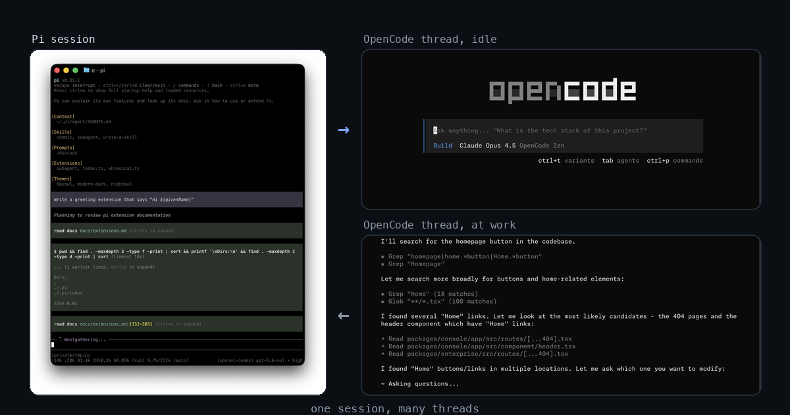

# pi-opencode-bridge

[](https://github.com/Barty13/pi-opencode-bridge/actions/workflows/test.yml)
[](https://www.npmjs.com/package/@barty13/pi-opencode-bridge)
[](LICENSE)



Delegate threads from a [Pi](https://github.com/badlogic/pi-mono) session to a local OpenCode
service. `oc_open` returns while the thread still runs. When the thread settles, Pi opens a new
turn with the answer. Your main session keeps working, and you keep the terminal.

## Install and requirements

Install from npm. For the newest work on `main`, install from git instead.

```sh
$ pi install npm:@barty13/pi-opencode-bridge                  # latest release
$ pi install git:github.com/Barty13/pi-opencode-bridge         # main, ahead of the release
```

- **OpenCode already installed and signed in.** Free or licensed, your choice. Start the service
  with `opencode serve --service`. The bridge reads the port from `opencode service status` and the
  password from `~/.config/opencode/service.json`. It never reads your provider keys.
- **Ghostty 1.3 or newer**, for the live columns. Each live thread gets one column that runs
  `opencode --session <id>`. This part is macOS only. Set `OC_PANES=0` to turn columns off.
- Pi 1.4 or newer. Bun runs the extension; Pi bundles it.

A running Pi keeps the code that it loaded, so restart Pi or resume the session after an update.

## Quick start

```sh
$ OC_ROOT=~/work/threads pi
```

```
> /oc
mode: supervised
service: http://127.0.0.1:…
armed: 0
served: opencode-go/…
> oc_models
> oc_open model: <id from oc_models> title: refactor-parser brief: …
```

## Tools

| Tool | What it does |
| --- | --- |
| [`oc_models`](docs/tools/oc_models.md) | Lists the models that the service serves for delegation, with each effort ladder. |
| [`oc_open`](docs/tools/oc_open.md) | Opens a thread for one self-contained task and returns its id. |
| [`oc_attach`](docs/tools/oc_attach.md) | Adopts a thread that the bridge did not open; arms a watch while it runs. |
| [`oc_fanout`](docs/tools/oc_fanout.md) | Sends one brief to several models; one merged report holds every section. |
| [`oc_send`](docs/tools/oc_send.md) | Hands an instruction to a thread and returns at once. |
| [`oc_steer`](docs/tools/oc_steer.md) | Corrects a running thread in place; applies at the next step boundary. |
| [`oc_rewind`](docs/tools/oc_rewind.md) | Undoes the last run: stage a revert, commit it, fork before it, or clear a stage. |
| [`oc_wait`](docs/tools/oc_wait.md) | Collects the settle inside the current turn, when a wake-up cannot arrive. |
| [`oc_read`](docs/tools/oc_read.md) | Shows the latest messages; `parts: "full"` adds reasoning and tool calls. |
| [`oc_reply`](docs/tools/oc_reply.md) | Answers an open permission or form ask by id. |
| [`oc_stop`](docs/tools/oc_stop.md) | Interrupts a running thread, or drops the watch with `detach: true`. |

## Commands

| Command | What it does |
| --- | --- |
| [`/oc`](docs/commands/oc.md) | Status: mode, service, threads with their status; adopted threads marked `attached`. |
| [`/oc-budget`](docs/commands/oc-budget.md) | Quota meters, live thread cost, and console budgets (`/oc_budget` also works). |
| [`/oc-attach`](docs/commands/oc-attach.md) | Adopts an existing thread under `OC_ROOT`. |
| [`/oc-auto`](docs/commands/oc-auto.md) | The model in this Pi session answers the asks. |
| [`/oc-accept`](docs/commands/oc-accept.md) | You answer the asks yourself. |
| [`/oc-kill`](docs/commands/oc-kill.md) | Stops a thread. |
| [`/oc-clean`](docs/commands/oc-clean.md) | Lists or deletes finished threads. |
| [`/oc-panes`](docs/commands/oc-panes.md) | Controls the Ghostty columns. |

The long rules live on their own pages: [attach](docs/tools/oc_attach.md),
[steering](docs/tools/oc_steer.md), [rewind](docs/tools/oc_rewind.md),
[digest](docs/wake-up.md), [context ceiling](docs/tools/oc_send.md), [budget](docs/budget.md),
[fan-out](docs/tools/oc_fanout.md), [supervision](docs/supervision.md), and
[boundary](docs/sandbox.md). The full index is [docs/README.md](docs/README.md).

## How a thread finishes

1. `oc_send` posts the prompt and returns. The thread is armed: the bridge now owes one wake-up.
2. The OpenCode event stream reports `session.execution.{succeeded,failed,interrupted}`. Four requests
   per armed thread every `OC_BACKSTOP_MS` (one session GET, one message GET, two ask GETs) cover
   dropped frames.
3. Detect claims the thread once, snapshots the answer, and releases one debounced message per
   batch. Two settles produce one message.
4. `oc_wait` waits on that same detector, so a collected answer never wakes the model twice.
5. A run already reported answers `already reported` instead of a second copy. `oc_wait` with
   `since` and `oc_read` read the record freely.

A batch waits for a compaction to end, or for the next human-started run after an escape ends a run
you dropped. Print and JSON carry no wake-up; [lifecycle.md](docs/lifecycle.md) and
[wake-up.md](docs/wake-up.md) give the full rules.

## Environment

| Variable | Default | Effect |
| --- | --- | --- |
| `OC_ROOT` | `process.cwd()` | Thread root; all threads must sit under it. |
| `OC_SERVICE_FILE` | `~/.config/opencode/service.json` | File with the service password. |
| `OC_RETENTION` | `{}` | JSON map from a model id suffix to a display label. Display only. |
| `OC_DEBOUNCE_MS` | `400` | Batch window for wake-ups, in ms. |
| `OC_BACKSTOP_MS` | `5000` | Gap between backstop polls, in ms. |
| `OC_WATCH_TTL_S` | `1800` | Watch life, in seconds. |
| `OC_WAIT_MAX_S` | `300` | Ceiling for `oc_wait`, in seconds. |
| `OC_COMPACT_TOKENS` | `500_000` | Thread size above which a send orders a compaction first; `0` turns the gate off. |
| `OC_BUDGET_PCT` | `0` | Refuse open and send while the Go rolling meter is at or above this percent; `0` turns it off. |
| `OC_BUDGET_TOKENS` | `0` | Cap the token total of delegated threads; `0` turns it off. |
| `OC_HUD` | `on` | `0` removes the footer and the thread table. |
| `OC_PANES` | `oc-panes next to the extension` | Path to the pane script; `0` turns columns off. |
| `OC_PANES_FONT` | `13` | Font size in a new pane. |

[docs/environment.md](docs/environment.md) lists every variable, including the RPC and check names.

## Limits

- One OpenCode service per bridge, no remote host, no proxy.
- Live columns need macOS plus Ghostty. They stay off in print, JSON, and RPC mode.
- The watch ceiling is in [lifecycle.md](docs/lifecycle.md). An `oc_open` without a brief creates an
  idle thread with no watch. A watch older than `OC_WATCH_TTL_S` expires and reports itself.
- Message body caps and `offset` paging are in [oc_read](docs/tools/oc_read.md).
- Deleting a thread outside the bridge ends its watch at the next read; the bridge drops the watch.
  Clean up after the settle with `/oc-clean force`, not mid-run.

## License

MIT. See [LICENSE](LICENSE). Report issues through [SECURITY.md](SECURITY.md).

## Picture

`assets/banner.png` comes from `gallery/render.py`. Run `bash gallery/fetch.sh` first: it pulls the
producers' own screens, the Pi terminal screenshot from pi-mono and the OpenCode splash and working
screens from opencode. Trademarks belong to their owners. No operator screenshot appears in it.
